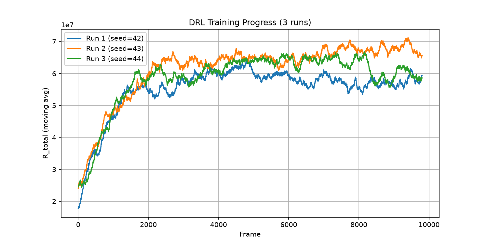
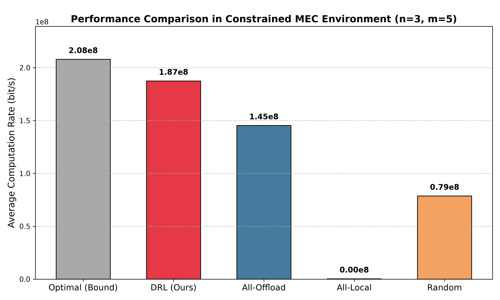

# Decentralized Optimization for WP-MEC HetNets

A deep reproduction and architecture refinement of the hybrid **DRL** and **Convex Optimization** framework for Wireless-Powered Mobile Edge Computing.

## Core Highlights
- **System Reproduction**: Implemented the WP-MEC physical model (WPT, Shannon, Fading) and Lagrangian-based bandwidth allocation (Newton/Bisection methods).
- **Architecture Optimization**: Solved the "free-rider" problem in the original global reward setup by introducing an **Independent Advantage Update** and **Temperature Decay** for stable Multi-Agent training.

## Results

### 1. Training Convergence (Stable across 3 seeds)


### 2. Performance Comparison
Achieves **~90% of the brute-force theoretical upper bound** under dynamic fading channels, significantly outperforming heuristic baselines.


## Quick Start
```bash
# Train the DRL agents
python main.py

# Generate the comparison chart
python plot_comparison.py
